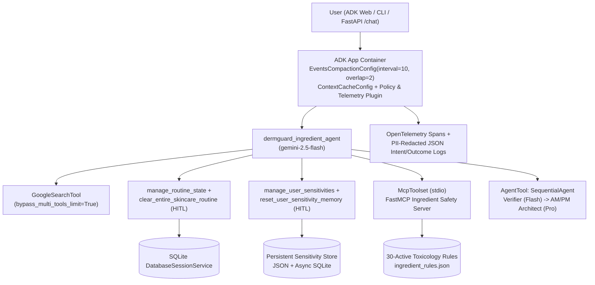

# DermGuard: Conversational Skincare Ingredient & Conflict Analyst

**DermGuard** is a conversational cosmetic toxicology and skincare routine compatibility agent built with the **[Google Agent Development Kit (ADK)](https://google.github.io/adk-docs/)** and **Model Context Protocol (`FastMCP`)**.

---

## 1. Problem & Solution

### Problem Statement
Skincare shoppers routinely combine cleansers, exfoliating toners, retinoids, antioxidants, and moisturizers without knowing exact **INCI (International Nomenclature of Cosmetic Ingredients)** lists or cross-product biochemical interactions. Layering incompatible actives (such as **Glycolic Acid + Retinol** or **Benzoyl Peroxide + Tretinoin**) or unknowingly stacking multiple products containing the same active (such as **Salicylic Acid** in both a cleanser and a leave-on BHA serum) frequently causes barrier disruption, chemical over-exfoliation, and acute irritation.

### Solution
DermGuard combines grounded online product ingredient discovery with deterministic cosmetic toxicology verification:
1. **Live INCI Discovery (`GoogleSearchTool(bypass_multi_tools_limit=True)`):** Resolves official brand product INCI lists directly from product names while coexisting seamlessly alongside custom `FunctionTool`s and `McpToolset` tools.
2. **Incremental Multi-Turn Routine State (`manage_routine_state`):** Tracks the user's active routine in persistent session state (`active_routine_products` backed by `DatabaseSessionService`). Adding a product in a later turn automatically cross-evaluates the entire combined product set.
3. **Deterministic Toxicology MCP Server (`FastMCP` over stdio):** Evaluates 30 seeded skincare actives for **pairwise conflicts**, **cumulative multi-product stacking**, **high-dose cautions**, **photosensitivity (SPF 30+ requirements)**, and **pregnancy/sensitivity contraindications**.
4. **Persistent Cross-Session User Sensitivity Memory (`manage_user_sensitivities`):** Remembers sensitivities (`sensitive_skin`, `rosacea`, `pregnant`, `eczema`, `fragrance_allergy`, `retinoid_intolerance`) across sessions in SQLite + JSON with non-blocking asynchronous consolidation.
5. **Strategic Model Routing & Multi-Agent Delegation:** Uses `gemini-2.5-flash` for low-latency search and state orchestration, `gemini-2.5-flash-lite` for asynchronous 10-turn sliding-window compaction, and a `SequentialAgent` pipeline (`biochemical_conflict_verifier_agent` → `am_pm_schedule_architect_agent` on `gemini-2.5-pro`) via `AgentTool` for complex multi-active AM/PM routine scheduling.

---

## 2. Architecture



---

## 3. Repository Structure

```text
dermguard/
├── __init__.py                  # ADK package entry point (exports root_agent & app)
├── agent.py                     # Root LlmAgent, constitutional prompt, MCP wiring & App compaction
├── config.py                    # Runtime config + Google Cloud Secret Manager loader
├── server.py                    # FastAPI server (/health, /chat) with SQLite DatabaseSessionService
├── sub_agents.py                # SequentialAgent AM/PM planner (Flash verifier -> Pro architect)
├── data/
│   ├── seed_ingredients.py      # Deterministic generator for 30 skincare actives & conflict rules
│   └── ingredient_rules.json    # Seeded zero-dependency cosmetic toxicology dataset
├── guardrails/
│   └── policy_plugin.py         # ADK BasePlugin: medical refusal guardrails & Intent/Outcome logs
├── mcp_server/
│   └── ingredient_safety_mcp.py # Local FastMCP server (analyze_routine_safety, caution profiles)
├── observability/
│   ├── pii_redactor.py          # Regex + optional Google Cloud DLP PII scrubbing
│   ├── structured_logger.py     # Cloud Logging JSON formatter with trace_id & span_id
│   └── tracing.py               # OpenTelemetry TracerProvider & Cloud Trace exporter
└── tools/
    ├── schemas.py               # Strict Pydantic input/output JSON schemas
    ├── routine_tools.py         # Incremental session routine tools + HITL confirmation hook
    └── memory_tools.py          # Async persistent user sensitivity memory + HITL reset hook
deployment/
└── terraform/                   # IaC for Cloud Run, Artifact Registry, Secret Manager, IAM, Trace
specs/
├── ARCHITECTURE.md              # Architecture & BDD scenarios
└── dermguard_spec.yaml          # Structured technical specification
tests/
├── test_dermguard.py            # Deterministic pytest suite
└── eval/                        # Golden evaluation dataset & regression harness
```

---

## 4. Quickstart & Local Setup

### Prerequisites
- Python **3.11+**
- [`uv`](https://docs.astral.sh/uv/) package manager
- A Gemini API key ([Google AI Studio](https://aistudio.google.com/)) or Google Cloud Vertex AI credentials

### 1. Install Dependencies & Seed Toxicology Database

```bash
# Install runtime and test dependencies
uv sync --extra dev

# Configure environment variables
cp .env.example .env
# Edit .env and set GOOGLE_API_KEY=your_api_key_here (or Vertex AI project settings)

# Deterministically generate the 30-active toxicology ruleset
uv run python -m dermguard.data.seed_ingredients
```

### 2. Run Interactive ADK Web Playground or CLI

```bash
# Launch the interactive ADK Web UI
uv run adk web .

# Or run directly in the terminal via ADK CLI
uv run adk run dermguard
```

You can also inspect, test, and manage the agent lifecycle with `google-agents-cli` (`agents-cli`):

```bash
uv tool install google-agents-cli
agents-cli run "I have sensitive skin. What is in The Ordinary Glycolic Acid 7% Toning Solution?"
agents-cli playground
```

### 3. Run the FastAPI Server & Test with `curl`

```bash
uv run uvicorn dermguard.server:fastapi_app --host 0.0.0.0 --port 8000
```

In a second terminal, execute the multi-product cumulative stacking test:

```bash
curl -s -X POST "http://localhost:8000/chat" \
  -H "Content-Type: application/json" \
  -d '{
    "user_id": "demo_user",
    "session_id": "sess_1",
    "message": "I have sensitive skin. Can I use CeraVe Renewing SA Cleanser and Paula'\''s Choice 2% BHA Liquid Exfoliant together?"
  }'
```

---

## 5. Testing & Automated Evaluation

### Run Deterministic Unit & Contract Tests

```bash
uv run pytest -v
```

### Run Golden Evaluation Suite

```bash
# Static schema & deterministic toxicology parity check
uv run python tests/eval/run_eval.py

# Optional live LLM-as-a-judge trajectory evaluation (requires GOOGLE_API_KEY)
RUN_LIVE_ADK_EVAL=true uv run python tests/eval/run_eval.py
```

---

## 6. Cloud Infrastructure & Deployment (Terraform / Cloud Run)

DermGuard ships with complete **Terraform** Infrastructure-as-Code (`deployment/terraform/`) and a non-root `Dockerfile`:
- **Secret Management:** Injects `GOOGLE_API_KEY` via **Google Cloud Secret Manager** (`GOOGLE_API_KEY_SECRET_ID`) or uses keyless **Vertex AI IAM** (`roles/aiplatform.user`).
- **Observability:** Exports OpenTelemetry traces to **Google Cloud Trace** (`OTEL_TRACES_EXPORTER=google_cloud_trace`), emits structured JSON `INTENT`/`OUTCOME` logs to **Cloud Logging**, and supports **Cloud Sensitive Data Protection (DLP)** (`ENABLE_CLOUD_DLP=true`).

```bash
# Build and push container image to Artifact Registry
gcloud builds submit --tag us-central1-docker.pkg.dev/$PROJECT_ID/dermguard-agent-repo/dermguard:1.0.0

# Provision Cloud Run, IAM Service Account, Secret Manager & Cloud Trace bindings
cd deployment/terraform
terraform init
terraform apply \
  -var="project_id=$PROJECT_ID" \
  -var="region=us-central1" \
  -var="container_image=us-central1-docker.pkg.dev/$PROJECT_ID/dermguard-agent-repo/dermguard:1.0.0"
```

---

## License

Licensed under the [Apache License 2.0](LICENSE).
