# DermGuard: Conversational Skincare Ingredient & Conflict Analyst

## 1. Problem Statement & Scope Boundaries

### 1.1 Problem Statement
Skincare shoppers frequently combine multiple products (cleansers, toners, serums, retinoids, moisturizers) without knowing their exact INCI (International Nomenclature of Cosmetic Ingredients) lists or how active ingredients interact across a routine. Mixing incompatible actives (e.g., Glycolic Acid + Retinol, or Benzoyl Peroxide + Tretinoin) or stacking multiple products containing the same active ingredient (e.g., Salicylic Acid in both a cleanser and a leave-on serum) causes chemical irritation and skin barrier damage.

### 1.2 Bounded Agentic Architecture Scope
**DermGuard** is a text-only, conversational agentic application built with the **Google Agent Development Kit (ADK)**. Its scope covers:
1. **Product Ingredient Discovery:** Using ADK's built-in `GoogleSearchTool(bypass_multi_tools_limit=True)` to retrieve official INCI ingredient lists from online product pages based on product names provided by the user.
2. **Incremental Routine Re-Evaluation:** Maintaining the user's current list of products and resolved ingredients in persistent session state (`tool_context.state["active_routine_products"]` backed by `DatabaseSessionService`). When a user adds or removes a product mid-conversation, the agent automatically re-evaluates the new product's ingredients against all existing products in the routine.
3. **Conflict & High-Dose Caution Analysis:** Using a local **FastMCP Ingredient Safety Server** (`McpToolset`) alongside Gemini's biochemical reasoning to flag:
   - **Damaging Ingredient Mixes:** Pairwise chemical conflicts (pH incompatibility, mutual oxidation, peptide hydrolysis, over-exfoliation).
   - **Dosage & Caution Warnings:** Ingredients requiring caution at high concentrations, cumulative multi-product stacking, photosensitivity (requiring SPF), or contraindications against the user's persistent sensitivity profile.
4. **Strategic Model Routing & Multi-Agent Delegation:** Orchestrating `dermguard_ingredient_agent` (`gemini-2.5-flash`) for low-latency search and state management, `LlmEventSummarizer` (`gemini-2.5-flash-lite`) for asynchronous context compaction, and a `SequentialAgent` AM/PM conflict-resolution pipeline (`biochemical_conflict_verifier_agent` + `am_pm_schedule_architect_agent` on `gemini-2.5-pro`) exposed via `AgentTool` when complex multi-active routines require split AM/PM scheduling.
5. **Persistent User Sensitivity Memory & Async Consolidation:** Remembering user-specific sensitivities (e.g., `rosacea`, `pregnant`, `sensitive_skin`, `fragrance_allergy`) across sessions via persistent SQLite/JSON storage with non-blocking asynchronous consolidation and PII redaction.
6. **Context Compaction & Caching:** Automatically compacting session history every 10 user queries via `EventsCompactionConfig(compaction_interval=10, overlap_size=2)` paired with `ContextCacheConfig`.
7. **Safety Guardrails, Human-in-the-Loop Hooks & AgentOps Observability:** Enforcing medical non-diagnosis guardrails via ADK `BasePlugin`, requiring human confirmation (`require_confirmation=True`) before destructive routine or profile resets, and emitting OpenTelemetry spans plus PII-redacted structured JSON Intent/Outcome logs.

---

## 2. System Architecture Diagram

```dot
digraph DermGuardArchitecture {
  rankdir=TB;
  node [shape=box, style="rounded,filled", fillcolor="#f8f9fa", fontname="Roboto"];
  edge [fontname="Roboto", fontsize=10];

  user [label="User (Text Chat / FastAPI / ADK Web)\nAdds Products & Sensitivities Over Turns", fillcolor="#e8f0fe"];

  subgraph cluster_app {
    label = "ADK App Container (EventsCompactionConfig: interval=10, overlap=2 + Policy & Telemetry Plugin)";
    style = "dashed";
    color = "#1a73e8";

    agent [label="dermguard_ingredient_agent (Root LlmAgent)\nmodel: gemini-2.5-flash", fillcolor="#e6f4ea"];

    search_tool [label="Tool 1: GoogleSearchTool\n(bypass_multi_tools_limit=True)\nOnline Product INCI Lookup", fillcolor="#e8f0fe"];
    routine_tool [label="Tool 2: manage_routine_state +\nclear_entire_skincare_routine (HITL)", fillcolor="#e8f0fe"];
    memory_tool [label="Tool 3: manage_user_sensitivities +\nreset_user_sensitivity_memory (HITL)", fillcolor="#e8f0fe"];
    mcp_toolset [label="Tool 4: McpToolset (stdio)\nLocal FastMCP Ingredient Safety Server", fillcolor="#fff8e1"];
    planner_pipeline [label="Tool 5: AgentTool -> SequentialAgent\nVerifier (Flash) -> AM/PM Architect (Pro)", fillcolor="#fce8e6"];
  }

  web [label="Live Web Search\n(Brand PDPs / INCIDecoder)", fillcolor="#f1f3f4"];
  rules_db [label="Zero-Dependency Seeded Rules\n(30 Actives & Pairwise Conflict Matrix)", fillcolor="#f1f3f4"];
  persist_store [label="Persistent SQLite + JSON Stores\n(Sessions & User Sensitivity Memory)", fillcolor="#f1f3f4"];
  otel [label="OpenTelemetry Spans &\nPII-Redacted Structured JSON Logs", fillcolor="#f1f3f4"];

  user -> agent;
  agent -> search_tool [label="1. Fetch INCI list"];
  search_tool -> web;
  agent -> routine_tool [label="2. Append product & get full routine"];
  routine_tool -> persist_store;
  agent -> memory_tool [label="3. Async Load/Save sensitivities"];
  memory_tool -> persist_store;
  agent -> mcp_toolset [label="4. Check conflicts & cumulative dose"];
  mcp_toolset -> rules_db;
  agent -> planner_pipeline [label="5. Multi-active AM/PM synthesis"];
  agent -> otel [label="Intent vs. Outcome traces"];
}
```

---

## 3. Behavior-Driven Development (BDD) Scenarios

### Scenario 1: Initial Product Lookup & Caution Flagging
* **Given** a user with persistent sensitivity `"sensitive_skin"` asks: *"What is in The Ordinary Glycolic Acid 7% Toning Solution, and is it safe for me?"*
* **When** the agent runs:
  1. It loads `"sensitive_skin"` via `manage_user_sensitivities`.
  2. It searches for the product's INCI list via `GoogleSearchTool`.
  3. It stores the product in `tool_context.state["active_routine_products"]` via `manage_routine_state`.
  4. It calls the MCP tool `analyze_routine_safety` with the extracted ingredients and sensitivity profile.
* **Then** the agent lists the key ingredients (`Glycolic Acid 7%`), flags a `HIGH_DOSE_CAUTION` and `SENSITIVITY_CONTRAINDICATION` (7% free acid is strong for sensitive skin and causes photosensitivity), and advises limiting frequency and wearing daily SPF.

### Scenario 2: Incremental Product Addition & Cross-Evaluation
* **Given** `"The Ordinary Glycolic Acid 7% Toning Solution"` is already in the user's active routine from Turn 1
* **When** the user asks in Turn 2: *"What if I also add CeraVe Resurfacing Retinol Serum at night?"*
* **Then** the agent:
  1. Uses `GoogleSearchTool` to find the INCI list for `CeraVe Resurfacing Retinol Serum` (`Retinol`, `Niacinamide`, `Ceramides`).
  2. Appends it to `tool_context.state["active_routine_products"]`.
  3. Re-evaluates the combined ingredient set (`Glycolic Acid` + `Retinol` + `Niacinamide`) via `analyze_routine_safety`.
  4. Flags a `PAIRWISE_CONFLICT` between `Glycolic Acid` and `Retinol` (barrier over-exfoliation and irritation) and recommends alternating nights rather than layering in the same PM session.

### Scenario 3: Session Compaction on Turn 10
* **Given** a user has completed 10 conversational turns exploring various products
* **When** the 10th invocation completes inside `App`
* **Then** `EventsCompactionConfig(compaction_interval=10, overlap_size=2)` triggers `LlmEventSummarizer` to compact turns 1–8 into a concise summary while preserving the last 2 turns verbatim and keeping `tool_context.state` and persistent sensitivity memory intact.

### Scenario 4: Out-of-Scope Medical Refusal
* **Given** a user asks the agent to diagnose a skin rash or prescribe a steroid/antibiotic
* **When** the agent processes the prompt
* **Then** the policy guardrail and agent constitution decline medical diagnosis, state that DermGuard is strictly a cosmetic ingredient information tool, and recommend consulting a board-certified dermatologist.
